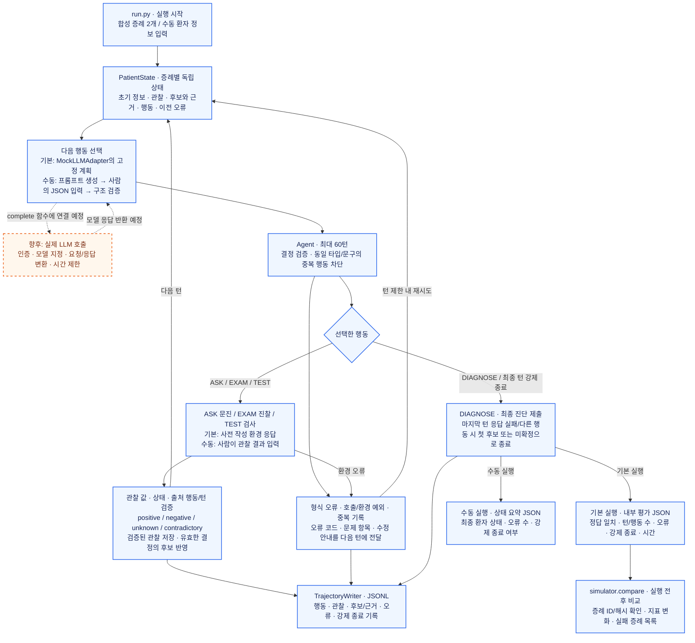
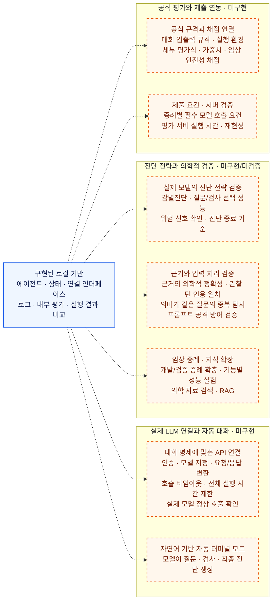

# N.O.V.A. Medical Agent — local baseline

N.O.V.A. 2026 대화형 의료 진단 AI 에이전트 대회용 **로컬 실행 및 LLM 연결 준비 프로젝트**입니다. 환자 상태를 프롬프트로 만들고, 구조화된 응답을 검증하며, 관찰을 다음 판단에 전달하는 흐름을 구현했습니다. 현재 포함된 두 증례와 판단 규칙은 코드 연결을 검증하기 위한 장난감 예제입니다. 실제 의료 진단 성능이나 공식 대회 점수를 뜻하지 않습니다.

**현재는 로컬 실행과 LLM 연결 준비까지 구현했습니다. 실제 LLM 연결은 미구현입니다.** 아래에서 지금 사용할 수 있는 기능과 앞으로 개발할 기능을 구분합니다.

## 기능 다이어그램

파란색 실선 상자는 **구현 완료**, 주황색 점선 상자는 **미구현·향후 작업**입니다. 점선 화살표는 향후 연결 지점을 뜻합니다.

### 현재 실행 흐름과 LLM 연결 지점



현재 자동 실행은 고정 Mock이며, 수동 실행의 모델 응답과 관찰은 사람이 입력합니다. 후보와 근거는 반환된 값을 저장하며 의학적 정확성을 검증하지 않습니다. 증례의 정답은 기본 실행의 내부 평가에만 사용하고 에이전트 상태·프롬프트에는 전달하지 않습니다. 수동 실행에는 정답률 평가와 실행 전후 비교를 적용하지 않습니다.

### 향후 구현·검증 범위

아래는 기존 미구현 목록을 기능별로 묶은 다이어그램입니다. 화살표는 확장 관계를 나타내며 개발 순서나 완료 일정을 뜻하지 않습니다.



## 1. 구현 완료

### 기능 목록

| 영역 | 상태 |
|---|---|
| 에이전트 실행 | 문진·진찰·검사·진단, 최대 60턴, 중복 차단과 오류 기록 구현 |
| 환자 상태 | 증례별 독립 상태, 관찰 출처 검증, 후보와 근거 저장 구현 |
| LLM 연결 준비 | 프롬프트 생성, JSON 파싱·검증, 호출 함수 주입 구현 |
| 로컬 실행 | 고정 Mock으로 합성 증례 2개 실행 및 내부 지표 계산 |
| 터미널 입력 | 사람이 모델 응답과 관찰을 입력하는 수동 테스트 구현 |
| 오류 진단 | 오류 코드·문제 항목·수정 안내를 로그와 다음 프롬프트에 전달 |
| 실행 결과 비교 | 같은 증례의 정확도·오류율·행동 수·강제 종료율·시간 비교 |

현재 자동 실행은 `MockLLMAdapter`, 수동 실행은 사람이 작성한 응답을 사용합니다. 후보 갱신은 반환된 후보와 근거를 상태에 반영하는 기능입니다.

### 실행 방법

Python 3.8 이상에서 프로젝트 루트로 이동해 실행합니다. 외부 패키지 설치나 API 키는 필요하지 않습니다.

```powershell
python run.py
python run.py --case toy-abdominal-pain
python run.py --interactive
python -m unittest discover -s tests -v
```

각 실행은 `runs/`에 새로운 JSONL trajectory와 JSON 평가 요약을 생성합니다. 출력 경로는 `--output-dir`로 바꿀 수 있습니다. `runs/`는 Git 추적에서 제외됩니다.

### 터미널에서 직접 입력하기

```powershell
python run.py --interactive
```

이 모드는 **실제 LLM 없이 사람이 모델 응답과 환자 답변을 대신 입력하는 연결 테스트**입니다. 자유로운 증상 문장을 입력할 수 있지만 AI가 자동으로 답하지는 않습니다.

1. 주증상(예: `어제부터 배가 아파요`)과 나이를 입력합니다.
2. 생성된 시스템 지침과 환자 상태 프롬프트가 표시됩니다.
3. 아래 예시를 모델 응답으로 붙여 넣고 **Enter를 한 번 더 눌러 빈 줄로 제출**합니다. 여러 줄 JSON도 가능합니다.

```json
{"action":{"type":"ASK","content":"통증은 어디에 있나요?"},"rationale":"위치 확인","differential":[]}
```

4. 관찰 결과(예: `배꼽 주변이 아파요`)와 상태(예: `positive`)를 입력합니다. 상태를 생략하면 `unknown`입니다.
5. 다음 턴의 프롬프트에 입력한 관찰이 포함되는지 확인합니다. 아래 응답을 입력하고 빈 줄로 제출하면 종료합니다.

```json
{"action":{"type":"DIAGNOSE","content":"미확정"},"rationale":"연결 테스트 종료","differential":[]}
```

잘못된 JSON은 오류를 기록하고 다음 턴으로 넘어갑니다. 어느 입력에서나 `/quit` 또는 `Ctrl+C`로 중단할 수 있습니다. 완료 시 `runs/manual-*.jsonl`과 상태 요약 JSON을 저장하며, 중단 시에는 이미 기록한 JSONL만 보존합니다. 수동 테스트에는 정답률을 계산하지 않습니다.

### 파일별 역할과 실행 흐름

| 파일 | 역할 |
|---|---|
| `run.py` | 증례를 읽고 새 Agent와 상태를 증례마다 만들며, 결과를 기록·평가하는 시작점 |
| `src/actions.py` | `ASK`, `EXAM`, `TEST`, `DIAGNOSE` 타입, 내용 검증, 동일 행동 판별 키 |
| `src/state.py` | 환자 정보, 출처가 있는 관찰, 감별진단, 수행한 행동을 보관하는 `PatientState` |
| `src/llm.py` | 상태 기반 프롬프트, JSON 응답 검증, 호출 함수 연결용 `StructuredLLMAdapter`, 고정된 `MockLLMAdapter` |
| `src/agent.py` | 최대 60턴 반복, 중복·형식 검사, 관찰 반영, 최종 진단 제출 |
| `src/trajectory.py` | 턴마다 행동·관찰·감별진단·오류를 JSONL로 저장 |
| `simulator/environment.py` | 행동에 해당하는 사전 작성 응답만 반환하는 로컬 환자 환경 |
| `simulator/evaluator.py` | 정답 여부, 턴·행동 수, 중복·형식 오류·실행 실패·시간 계산 |
| `simulator/compare.py` | 기본 실행 요약 두 개 비교와 실패 증례 목록 출력 |
| `simulator/sample_cases.json` | 코드 검증용 합성 증례 두 개 |
| `assets/source_manifest.json` | 포함된 자료의 출처·라이선스 기록 |

`run.py` → 증례의 초기 정보로 `PatientState` 생성 → adapter가 다음 `Action` 선택 → Agent가 검사 → 환경이 해당 관찰만 반환 → 상태와 trajectory 갱신 → `DIAGNOSE` 후 평가 순서로 실행됩니다. Agent에는 증례 정답이나 아직 요청하지 않은 응답이 전달되지 않습니다. 증례마다 새 환경과 상태를 만들어 정보가 섞이지 않습니다.

`Observation.status`는 `positive`, `negative`, `unknown`, `contradictory` 중 하나입니다. 정보가 정의되지 않은 행동은 `unknown`으로 처리하므로, 묻지 않은 사실을 음성 소견으로 간주하지 않습니다. 중복 행동은 공백·대소문자를 정규화한 **동일 타입·동일 문구**일 때 탐지합니다.

`sample_cases.json`의 `diagnosis`는 평가용 정답이며 프롬프트에 전달하지 않습니다. 현재 Mock의 고정 계획에도 예제 진단이 작성되어 있으므로, 예제 정답률은 일반화 성능을 나타내지 않습니다.

### 프롬프트·응답 검증·상태 갱신

`StructuredLLMAdapter`는 `complete(messages) -> str` 함수를 받아 다음 흐름을 실행합니다. 현재는 수동 입력 또는 테스트용 가짜 호출 함수로 검증합니다.

```text
PatientState → build_messages → complete → parse_decision → Decision
     ↑                                                      ↓
     └──── 검증된 환경 관찰 저장 ← Agent가 선택 행동 실행 ────┘
```

- `build_messages(state)`: 고정된 시스템 지침과 현재 증례 상태를 JSON으로 분리합니다. 초기 정보, 누적 관찰과 출처, 이전 후보와 근거, 성공한 행동, 남은 턴, 이전 오류를 담습니다. 환경의 정답·미공개 응답은 전달하지 않습니다.
- `parse_decision(text)`: JSON 객체 하나만 받습니다. 필수/추가/중복 키, 행동 종류와 내용, 근거 목록, 위험도, 중복 후보를 검증합니다. 설명문과 Markdown 코드 블록은 거부합니다. 모델이 관찰 목록을 직접 수정하는 출력도 허용하지 않습니다.
- `PatientState.add_observation`: 환경 관찰의 값·상태·출처 행동·턴을 확인한 후 저장합니다. 실패한 환경 요청은 완료된 행동으로 기록하지 않으므로 이후 턴에 재시도할 수 있습니다.
- 다음 모델 요청에 새 관찰과 기존 후보를 함께 넣고, 유효하고 중복되지 않은 결정의 후보 목록으로 상태를 갱신합니다. 파이썬 코드 자체가 임상 추론을 수행하는 것은 아닙니다.
- 마지막 턴에도 Adapter를 호출합니다. 구조화된 프롬프트에는 최신 관찰을 포함하고 `DIAGNOSE`를 요구합니다. 응답 실패 또는 다른 행동이면 기존 첫 후보/`미확정`으로 강제 종료하며 오류를 기록합니다.
- JSON/구조 오류는 `format_errors`, 호출·환경 예외는 `execution_failures`로 구분합니다. 다음 턴에 오류 종류와 상세 안내를 전달하며 전체 턴 제한 안에서 재시도합니다. 마지막 턴의 오류도 집계합니다. 강제 종료는 `forced_diagnosis`로 별도 기록합니다.

API 키 없이 연결 흐름을 검증하려면:

```powershell
python -m unittest discover -s tests -p test_llm.py -v
```

`tests/test_llm.py`의 가짜 호출 함수는 관찰 결과에 따라 서로 다른 응답을 반환합니다. 테스트는 최신 관찰 전달과 후보 갱신, 최종 턴 호출, 잘못된 출력, 관찰 출처 오류, 재시도, 증례 간 상태 분리를 확인합니다. 실제 모델의 추론 성능을 검증하는 것은 아닙니다.

### 검증 완료 범위와 로그

현재 자동 테스트는 총 25개이며 다음 범위를 확인합니다.

| 테스트 파일 | 확인 범위 |
|---|---|
| `tests/test_baseline.py` | 예제 종료, 증례별 상태 분리, 중복 차단, 잘못된 결정 처리 |
| `tests/test_llm.py` | 상세 오류, 60턴 연속 실패, 호출 시간 초과 후 복구, 미확인·충돌 관찰 보존, 중복 시 상태 보존, 최신 관찰 전달, 출처 검증 |
| `tests/test_console.py` | 실제 CLI 프로세스의 한글·여러 줄 JSON 입력, 관찰 반영, 종료 및 입력 중단 |
| `tests/test_compare.py` | 지표 계산, 파일별 증례 일치, 이전 로그 형식, 잘못된 파일 거부, 비교 CLI와 기본 실행 결과 통합 |

기본 예제 2개는 각각 4턴으로 종료합니다. 수동 모드도 터미널에서 관찰 입력부터 진단 제출까지 확인했습니다. 테스트 통과는 처리 흐름의 검증이며 실제 LLM 호출이나 의료적 타당성 검증을 뜻하지 않습니다.

- `.jsonl`: 한 줄이 한 턴입니다. 행동, 관찰, 판단 이유, 후보와 근거, 오류를 저장합니다.
- 기본 실행의 `-summary.json`: 예제 정답 일치 여부와 행동 수·오류·시간을 저장합니다. 행동 수는 성공한 정보 획득 행동 기준입니다.
- 수동 실행의 `manual-*-summary.json`: 입력으로 만든 최종 환자 상태와 오류 수를 저장합니다. 정답률은 계산하지 않습니다.
- `invalid_decision`: JSON 또는 결정 형식이 유효하지 않다는 뜻입니다. `duplicate_action`은 이미 성공한 행동의 반복, `adapter_error`와 `environment_error`는 각 실행 단계의 예외입니다.
- `error_detail`: 오류 코드(`code`), 문제 항목(`field`), 수정 안내(`message`)를 저장합니다. 다음 프롬프트의 `last_error_detail`과 수동 모드의 수정 안내에도 반영합니다. 유효한 결정 후에는 이전 오류 안내를 지웁니다.
- `forced_diagnosis`: 마지막 턴에 유효한 진단 응답을 받지 못해 프로그램이 대체 진단으로 종료했는지 표시합니다. 정상적인 `DIAGNOSE` 종료와 구분합니다.

실행 로그는 `runs/`에 보관되며 GitHub에 커밋하지 않습니다.

### 오류 수정 안내

기존 `error: "invalid_decision"`은 유지하고 상세 필드를 추가했습니다. 예를 들어 필수 항목이 누락되면 다음처럼 기록합니다.

```json
{"error":"invalid_decision","error_detail":{"code":"missing_fields","field":"response","message":"필수 항목 누락: rationale"}}
```

| 상세 코드 | 수정할 내용 |
|---|---|
| `invalid_json` | 안내된 행·열의 JSON 문법 확인, 설명문·코드 블록 제거 |
| `missing_fields` / `extra_fields` | 필수 항목 추가 또는 허용되지 않은 항목 제거 |
| `duplicate_key` | JSON 객체 내 중복 키 제거 |
| `invalid_action` | `ASK`, `EXAM`, `TEST`, `DIAGNOSE` 중 하나 사용 |
| `invalid_text` / `invalid_type` | 빈 문자열 또는 자료형 수정 |
| `invalid_evidence` / `invalid_risk` | 근거 목록 또는 위험도 형식 수정 |
| `duplicate_candidate` | 같은 질환 후보 중복 제거 |

호출 예외는 종류만 기록하며 외부 예외 메시지 전체를 로그나 프롬프트에 복사하지 않습니다. 시간 초과 테스트는 가짜 함수가 `TimeoutError`를 발생시키는 방식으로 복구 흐름을 검증합니다. 실제 호출 시간 제한 기능은 미구현 목록에 남아 있습니다.

### 실행 결과 비교

기본 실행을 변경 전후 각각 수행하고 출력된 `summary:` 경로 두 개를 사용합니다. 아래 파일명은 실제 생성된 파일명으로 바꾸세요.

```powershell
python -m simulator.compare runs/before-summary.json runs/after-summary.json
```

분석 결과를 JSON으로 받으려면 `--json`을 추가합니다.

```powershell
python -m simulator.compare runs/before-summary.json runs/after-summary.json --json
```

- 정확도, 평균 턴, 평균 성공 정보 획득 행동 수, 오류·형식 오류·실행 실패·중복 행동 비율, 강제 종료율, 평균 시간을 나란히 표시합니다.
- 오류 비율은 `(형식 오류 + 실행 실패 + 중복 행동) / 전체 턴 수`입니다. 강제 종료율은 `강제 종료 증례 / 전체 증례 수`이며 별도로 계산합니다. 비율의 변화는 퍼센트포인트(pp), 나머지 변화는 `이후 - 이전`입니다.
- 오답·오류·강제 종료가 있는 증례를 각 실행별로 모아 보여줍니다. 변화량만으로 개선을 자동 판정하지 않습니다.
- 증례 ID 구성이 다르면 비교를 거부합니다. 새 요약 파일에는 증례 파일의 SHA-256을 저장하며, 두 파일에 해시가 있으면 내용이 다를 때도 거부합니다. 증례 파일의 서식만 바뀌어도 해시가 달라집니다.
- 이전 요약 파일은 증례 ID만 비교하고 내용 동일성을 확인할 수 없다는 안내를 표시합니다. 강제 종료 필드가 없는 예전 결과는 0으로 간주하지 않고 `미상`으로 표시합니다.
- **기본 실행의 `-summary.json` 전용**입니다. 수동 실행과 원시 JSONL은 거부합니다. 이 도구는 개발 후 분석용이며, 에이전트가 다른 증례의 결과를 읽어 예측을 보정하지 않습니다.

## 2. 미구현·향후 작업

아래 항목은 현재 사용할 수 없거나 검증이 필요한 기능입니다.

### 실제 LLM 연결과 자동 대화

- [ ] 대회 접속 명세에 맞춘 API 인증·모델 지정·요청·응답 변환
- [ ] 호출 타임아웃과 전체 실행 시간 제한
- [ ] 실제 모델의 정상 호출 여부 확인
- [ ] 자연어 입력 후 모델이 질문·검사·최종 진단을 자동 생성하는 터미널 모드

지금 사람이 직접 입력하는 JSON은 실제 연결 후 LLM이 생성하게 됩니다. 현재는 실제 LLM 호출이 없으므로 대회의 증례별 필수 모델 호출 요건을 충족하지 않습니다.

실제 연결 시 구현할 함수는 `complete(messages) -> str`입니다. 아래는 연결 형태를 보여주는 예시이며 `complete`는 아직 구현하지 않았습니다.

```python
from src.agent import Agent
from src.llm import StructuredLLMAdapter

# complete에서 인증·모델 지정·타임아웃·요청 변환을 처리하고 응답 본문을 반환
agent = Agent(StructuredLLMAdapter(complete))
```

연결 함수는 다른 증례의 대화·예측을 기억하거나 재사용하지 않아야 합니다.

### 진단 전략과 의학적 검증

- [ ] 실제 모델을 이용한 감별진단·질문·검사 선택 성능 검증
- [ ] 위험 신호 확인과 진단 종료 기준의 임상적 검증
- [ ] 생성된 근거의 의학적 정확성과 관찰 턴 인용의 사실 일치 검증
- [ ] 의미가 같지만 문구가 다른 질문의 중복 탐지
- [ ] 프롬프트 공격에 대한 방어 검증
- [ ] 임상 개발·검증 증례 확충 및 실제 모델의 기능별 성능 실험
- [ ] 의학 자료 검색·RAG

현재 응답 검증은 **구조 검증**입니다. 위험도와 진단 후보는 반환된 가설이며, 프롬프트에 작성한 위험 확인·근거 사용 지침의 효과는 검증하지 않았습니다. 마지막 턴의 강제 종료는 성공적인 모델 호출이나 검증된 임상 판단을 뜻하지 않습니다.

### 공식 평가와 제출 연동

- [ ] 공식 대회 입출력 규격과 실행 환경 연결
- [ ] 공식 세부 평가식·가중치·임상 안전성 채점 반영
- [ ] 증례별 필수 모델 호출을 포함한 제출 요건 검증
- [ ] 평가 서버에서의 실행 시간·재현성 검증

현재 메시지·응답 구조는 프로젝트 내부 규격입니다. 정확도와 행동 횟수는 내부 지표이며, `safety_assessed: false`는 안전성 평가를 수행하지 않았다는 뜻입니다. 합성 증례 두 개의 결과로 실제 진단 성능이나 대회 점수를 판단할 수 없습니다.

공식 규정과 가이드: [진행 및 평가](https://nova.snubhai.org/evaluation/), [참가 규칙](https://nova.snubhai.org/rules/), [FAQ](https://nova.snubhai.org/faq/).
