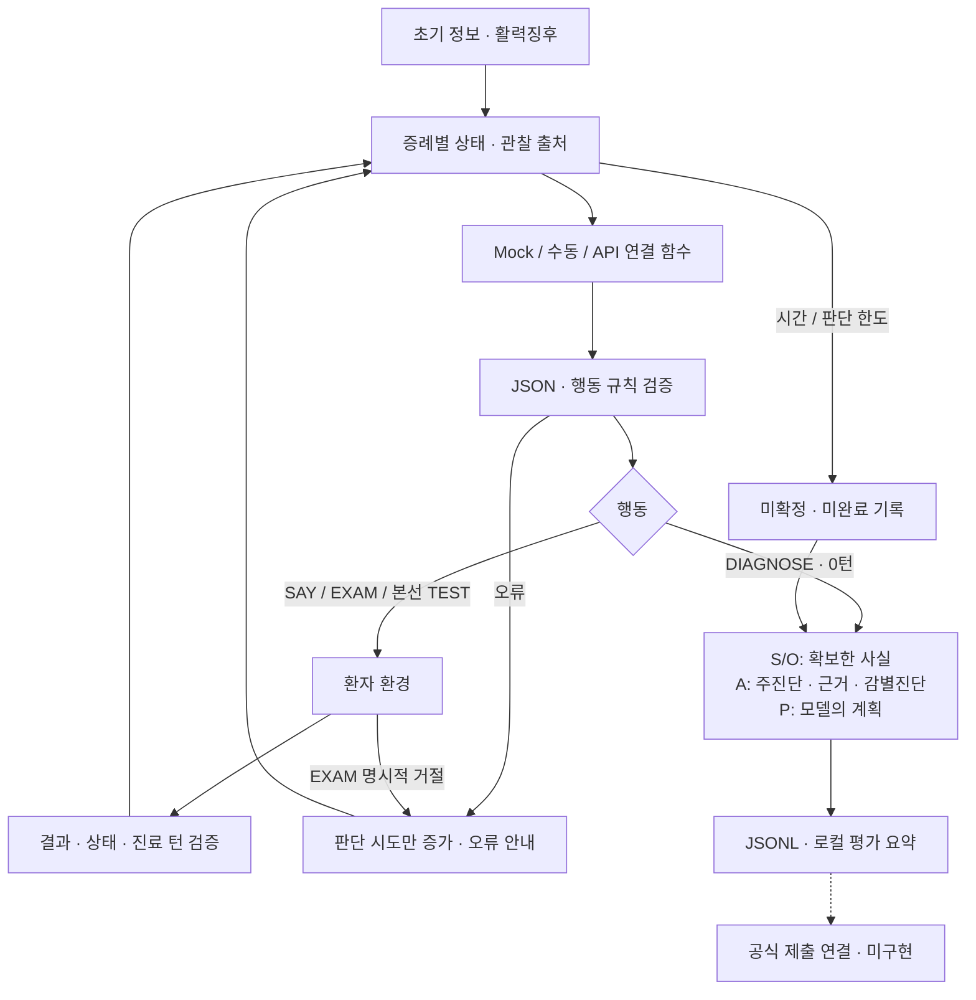

# N.O.V.A. Medical Agent — OT 기반 로컬 개발 환경

가상 환자를 진료하는 Doctor Agent의 로컬 개발 프로젝트입니다. **공식 API를 받기 전 단계**이며, 현재 자동 실행은 합성 증례와 고정 Mock을 사용합니다. 실제 대회 모델 호출·공식 환자 환경 연결·서버 제출은 아직 구현하지 않았습니다. 예제 정답률은 의료 성능이나 대회 점수가 아닙니다.

대회 기준은 사용자 제공 자료를 정리한 [OT 참고 기록](docs/OT_REFERENCE.md)을 따릅니다. 아래 JSON과 연결 함수는 **프로젝트 내부 규격**이며 공식 API 규격이 아닙니다.

## 실행

Python 3.8 이상, 표준 라이브러리만 사용합니다. API 키 없이 실행할 수 있습니다.

```powershell
python run.py --check-connection
python run.py
python run.py --case toy-abdominal-pain
python run.py --stage final
python run.py --interactive
python run.py --interactive --show-prompts
python -m unittest discover -s tests -v
```

- `--check-connection`: 환경변수 설정 여부와 요청 → 가짜 응답 → 파싱 흐름을 점검합니다. 네트워크 요청은 0회이며, 설정 값·비밀 키는 출력하지 않습니다. `real_api_verified: false`를 유지합니다.
- 기본 실행은 예선(`preliminary`)입니다. TEST를 차단하며 합성 증례 두 개는 각각 SAY 1회·EXAM 1회 후 DIAGNOSE로 종료합니다. 진료 2턴, 판단 시도 3회입니다.
- `--stage final`: 로컬 행동 규칙에서 TEST를 허용합니다. 본선 모델 구동 환경을 제공한다는 의미는 아닙니다.
- `--interactive`: 사람이 모델 JSON과 환자 답변을 입력하는 수동 연결 테스트입니다. 입력을 시간 제한 없이 기다리며, 사용자가 유효한 DIAGNOSE를 입력해야 진단을 확정합니다. 빈 입력은 무시하고 잘못된 JSON은 다시 입력받습니다. `/quit`·Ctrl+C·입력 스트림 종료 시에는 진단을 만들지 않고 중단합니다.
- 수동 모드 시작 시 터미널 화면과 복원된 스크롤 기록을 정리합니다. 저장된 실행 파일은 유지하며 새 테스트에 읽어 들이지 않습니다. 전체 시스템 지침·누적 상태는 기본적으로 출력하지 않으며 `--show-prompts`를 지정했을 때만 표시합니다.
- 수동 모드도 행동 규칙과 50턴 상한은 적용합니다. 50턴을 사용하면 추가 행동을 차단하고 DIAGNOSE 또는 중단 입력을 기다립니다. 자동 실행의 시간·판단 시도 제한은 수동 입력 대기에 적용하지 않습니다.
- 실행 기록은 `runs/`에 저장합니다. `--output-dir`로 경로를 변경할 수 있습니다.

## 현재 흐름



## OT 반영 범위

| 항목 | 구현 및 한계 |
|---|---|
| 진료 턴 | 최대 50턴. SAY·EXAM·본선 TEST는 실행 시 1턴, DIAGNOSE는 0턴 |
| 판단 시도 | 자동 실행에서 최대 200회. 진료 턴과 별도이며 오류·중복·거절의 무한 반복 방지용. 수동 입력에는 미적용 |
| 시간 | 자동 실행은 증례당 기본 1,200초, 기록 마감 여유 5초. 모델 응답은 최대 60초 대기. 수동 모드는 입력 시간 제한 없음 |
| SAY | 공백·문장부호 포함 Python `len` 기준 30자 이하. 명백한 복수 질문·개행 차단. 질문·설명·공감·교육에 사용 |
| EXAM | 하나의 동작을 문장으로 요청하도록 지침 제공. 명백한 묶음 표현 차단. 환경의 `ExamRejected`는 턴 미차감 |
| TEST | 예선 차단, 본선 허용. 예선 추가 검사 계획은 DIAGNOSE의 `plan`에 기록 |
| SOAP | S/O는 실제 받은 초기 정보·관찰로 구성. O에 결과 턴 기록. A는 주진단·근거·감별진단, P는 필수 계획 문자열 |
| 정보 보존 | positive / negative / unknown / contradictory 구분. 출처 행동·턴 불일치 거부 |
| 오류 및 로그 | 오류 코드·수정 안내 전달, 동일 타입·문구 중복 차단, JSONL 저장 |
| 모델 사용량 | 연결 어댑터에서 세션 호출 200회·입력 50만·출력 10만 예산 관리. 공식 토큰 계수기 연결 필요 |

문장 의미 전체를 코드로 판별하지는 않습니다. 물음표가 없는 복수 질문, 복잡하게 묶인 진찰, 임상적으로 충분한 검사·치료·추적 계획, 근거의 의학적 타당성은 별도 검증이 필요합니다. 30자 계산법과 세션 범위도 공식 명세 확인 후 조정해야 합니다.

시간 초과 시 **대기 종료** 후 미확정 SOAP를 남깁니다. Python 스레드의 실행 자체를 강제로 취소하지는 않으므로, 실제 통신 함수에도 전달된 타임아웃을 적용해야 합니다. 늦은 모델 응답이 환자 상태를 바꾸지 않도록 상태 사본을 전달하며, 연결 어댑터가 시간 초과되면 이후 호출을 차단합니다. 공식 서버에 마감 내 제출하는 보장은 서버 연동 후 검증해야 합니다.

명시적 EXAM 거절 외 환경 오류는 실행됐을 가능성이 있으므로 보수적으로 1턴을 계산합니다. 실제 서버의 턴 응답이 공개되면 그 값에 맞추어야 합니다.

## API를 받은 뒤 연결할 부분

`src/connection.py`의 `PreparedAPIAdapter`에 아래 두 함수를 주입합니다. 지금은 기본값이 미연결이며, 자동으로 외부 서비스를 호출하지 않습니다.

```python
# 내부 연결 계약입니다. 실제 HTTP 요청 형식은 공식 명세 수령 후 구현합니다.
complete(messages, *, model, timeout_seconds, max_output_tokens) -> ModelReply
count_input_tokens(messages, model) -> int
```

`complete`는 공식 서버 인증·요청 변환·I/O 타임아웃을 처리하고 응답 텍스트와 실제 입력/출력 토큰 수를 반환해야 합니다. `count_input_tokens`는 서버의 메시지 부가 토큰까지 포함한 보수적 상한을 계산해야 합니다. 현재 문자 수를 토큰 수로 가정하지 않습니다.

```python
from src.agent import Agent
from src.connection import PreparedAPIAdapter

# complete와 count_input_tokens는 공식 명세를 받은 뒤 구현합니다.
# competition=True는 실제 대회 전송 함수에만 지정합니다.
adapter = PreparedAPIAdapter(complete, count_input_tokens, competition=True)
agent = Agent(adapter, stage="preliminary")
```

- 모델 식별자는 예선의 `openai/gpt-oss-20b`로 고정합니다. 이 어댑터는 본선 로컬 모델 실행기가 아닙니다.
- 공식 세션마다 어댑터 하나를 유지해 호출·토큰 누적치를 공유해야 합니다. 환자 상태는 증례마다 새로 만듭니다. 세션 범위는 아직 미확정입니다.
- 출력 요청은 최대 4,096토큰과 남은 출력 예산 중 작은 값입니다. 4,096은 로컬 기본 요청 상한이며 대회 규정이 아닙니다.
- 사용량 누락·잘못된 사용량·통신 실패로 비용이 불명확하면 해당 연결 세션을 차단합니다. 임의로 예산을 초기화하지 않습니다.
- 토큰 사전 계산과 서버 응답 사용량이 맞지 않으면 중단합니다. 정확한 토큰 계산과 서버 측 한도 준수는 실제 API 연결 후 검증해야 합니다.
- `competition_model_calls`는 대회용으로 명시된 어댑터가 해당 증례에서 정상 수신한 응답 횟수입니다. 서버 평가 통과를 의미하지 않습니다. Mock·수동·연결 점검은 항상 0입니다.

환경변수 이름은 `NOVA_API_URL`, `NOVA_API_KEY`로 준비했습니다. `.env.example`은 작성 참고용이며 `.env` 자동 로딩은 하지 않습니다. 현재 환경변수를 채워도 실제 API가 연결되지는 않습니다. 인증 방식·경로·본문 구조는 추정해서 작성하지 않았습니다.

## 내부 모델 응답 형식

문진·설명·진찰 응답 예시:

```json
{"action":{"type":"SAY","content":"통증은 어디에 있나요?"},"rationale":"위치 확인","differential":[]}
```

종료 응답 예시:

```json
{"action":{"type":"DIAGNOSE","content":"미확정"},"rationale":"연결 테스트 종료","differential":[],"plan":"테스트용 기록입니다. 임상 평가와 구체적인 계획 수립이 필요합니다."}
```

DIAGNOSE의 `content`는 주진단 1개입니다. `plan`은 비어 있지 않은 문자열이 필수이며, 그 임상적 완전성을 구조 검증만으로 보장하지는 않습니다. 모델에는 추가 검사·치료·처치·추적·교육 계획을 작성하고 실제 설명은 SAY로 전달하도록 지시합니다.

감별진단 항목은 `name`, `supporting`, `opposing`, `missing`, `risk`를 사용합니다. 근거 목록은 문자열 배열이며, 위험도는 `unknown`, `low`, `medium`, `high` 중 하나입니다. 초기 정보나 관찰 턴을 근거에 명시하도록 지시하지만, 생성된 근거의 사실 일치는 아직 자동 검증하지 않습니다.

`ASK`는 `SAY`로 변경했습니다. 예전 모델 응답·증례 파일을 사용할 때 행동 이름을 바꿔야 합니다. JSON 문법·중복 키·추가 필드·자료형 오류는 다음 판단에 수정 안내로 전달합니다. 외부 예외 메시지 전체는 로그나 프롬프트에 복사하지 않습니다.

## 기록과 비교

- JSONL의 `turn`: 실제 진료 행동에 사용한 턴. `attempt`: 모델 판단 시도 번호. 거절·오류·DIAGNOSE는 동일 진료 턴 번호를 가질 수 있습니다.
- 마지막 JSONL 기록과 평가 요약에 `soap`가 포함됩니다. S/O는 받은 사실을 보존하며, 미확인 정보를 음성 소견으로 채우지 않습니다.
- `forced_diagnosis: true`: 시간·판단 한도·오류 때문에 정상 진료를 완료하지 못한 경우입니다. 기존 첫 후보를 확정하지 않고 `미확정`과 미수립 계획을 남깁니다.
- 요약의 `model_call_requirement_met`는 대회 모델 호출 여부만 표시합니다. 로컬 실행에서는 false입니다. `official_submission_sent`도 아직 false입니다.
- `safety_assessed: false`: 임상 안전성 평가를 수행하지 않았다는 뜻입니다.

```powershell
python -m simulator.compare runs/before-summary.json runs/after-summary.json
python -m simulator.compare runs/before-summary.json runs/after-summary.json --json
```

동일 증례·동일 단계·동일 집계 버전끼리 비교합니다. 새 요약은 `schema_version: 2`입니다. 60턴 방식의 과거 요약과 직접 비교하지 않으며, 같은 코드에서 다시 실행해야 합니다. 과거 요약끼리의 비교는 계속 지원합니다.

오류 비율은 `(형식 오류 + 실행 실패 + 중복 행동) / 판단 시도 수`입니다. 진료 0턴으로 끝나도 계산됩니다. 비교 JSON의 `error_turn_rate`, `duplicate_turn_rate` 키는 기존 소비자와의 호환을 위해 유지하지만, 새 형식의 분모는 판단 시도 수입니다. 예전 요약에는 이 정보가 없어 기존 턴 수를 사용합니다.

## 파일과 검증

| 파일 | 역할 |
|---|---|
| `run.py` | Mock·수동 실행 및 오프라인 연결 점검 |
| `src/connection.py` | API 연결 계약·사용량 관리·대기 기한·설정 읽기 |
| `src/llm.py` | 프롬프트·결정 JSON 검증·고정 Mock |
| `src/agent.py` | 행동 실행·진료 턴 및 판단 횟수·시간 한도·종료 |
| `src/actions.py` | SAY·EXAM·TEST·DIAGNOSE 및 단계별 규칙 |
| `src/state.py` | 초기 정보·활력징후·관찰·감별진단·SOAP 구성 |
| `src/trajectory.py` | JSONL 기록 |
| `simulator/` | 합성 환자 환경·내부 평가·실행 비교 |
| `tests/` | 기본·연결·콘솔·비교·OT 회귀 테스트 |
| `assets/source_manifest.json` | 포함 자료의 출처·라이선스 기록 |

38개 자동 테스트는 기존 상태·오류 처리와 함께 50회 행동 뒤 0턴 진단, EXAM 거절 후 같은 턴 재시도, 예선 TEST 차단, 길이 제한, SOAP의 관찰 출처, 지연된 응답 무시, 호출·토큰 예산, 0턴 평가 결과 비교를 확인합니다. 수동 모드의 입력 대기·오류 수정 중 자동 종료 방지, 기존 기록 미사용, 프롬프트 표시 옵션과 화면 정리도 검증합니다.

## 남은 작업

1. 공식 API 명세 수령 후 인증·전송·토큰 계산 연결 및 실제 모델 호출 확인.
2. 공식 초기 정보·환자 행동 응답·거절·턴 집계·SOAP 제출 프로토콜 연결.
3. 실제 모델에서 문진·설명·안전·감별진단·계획의 품질 검증. 현재 Mock에는 임상 추론이 없습니다.
4. 공식 서버에서 제한 시간·세션 예산·재현성·ZIP 50MB 이하 검증. 루트의 `run.py`, `requirements.txt`는 준비되어 있습니다.
5. 본선용 로컬 모델·A6000 실행 및 모델 자산 크기 검증.

OT의 공개 배점은 정보수집 25·진단추론 15·검사/추적 10·안전 15·의사소통 15·효율 20점입니다. 세부 채점식은 비공개이므로 내부 정답 일치 평가를 공식 점수처럼 사용하지 않습니다.
