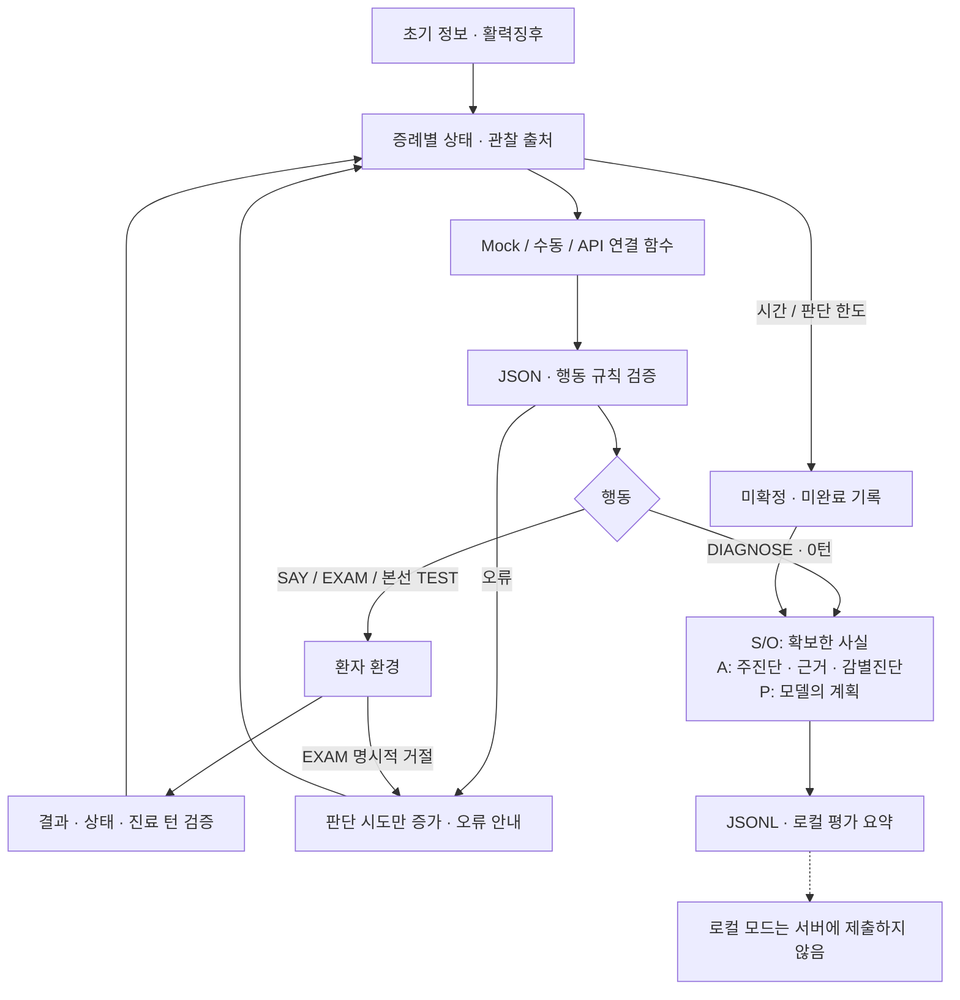

# N.O.V.A. Medical Agent — 공식 SDK 연동 및 로컬 개발

가상 환자를 진료하는 Doctor Agent 프로젝트입니다. **공식 SDK 1.0.0 연결을 구현했습니다.** 서버 세션에서는 지정 모델 호출 → 문진·진찰 → 공식 SOAP 작성 → DIAGNOSE 제출을 실행합니다. API 키 없는 기본 실행은 기존 합성 증례와 고정 Mock입니다. 예제 정답률은 의료 성능이나 대회 점수가 아닙니다.

공식 계약은 [개발 가이드](https://nova.snubhai.org/docs/)와 시작 패키지의 SDK를 따릅니다. [OT 참고 기록](docs/OT_REFERENCE.md)은 당시 자료의 기록입니다. 모델의 행동 판단 JSON은 내부 규격이며, 최종 제출은 SDK의 `empty_record()` 형식을 사용합니다. 실제 서버 인증·모델 동작·점수는 개발 키로 별도 검증해야 합니다.

## 공식 서버 샘플 실행

Python 3.12 기준, 추가 의존성은 없습니다. `.env.example`은 참고 파일이고 `.env`를 자동 로딩하지 않습니다. 개발 키는 본인의 환경변수로 설정하며 코드·ZIP·실행 로그에 넣지 않습니다.

```powershell
$env:NOVA_API_BASE = "https://nova.snubhai.org"
# PowerShell 7에서 키를 화면에 표시하거나 명령 기록에 남기지 않고 입력
$env:NOVA_DEV_KEY = Read-Host "개인 개발 API 키" -MaskInput
$env:NOVA_OUTPUT_DIR = Join-Path $PWD "runs"
python sample.py --list
python sample.py --case 공개샘플_UUID
```

`--list`는 샘플 목록만 조회합니다. `--case`는 지정 모델과 환자 API를 호출하므로 팀 개발 크레딧이 사용됩니다. 샘플 실행은 공식 평가 요청이 아닙니다. `sample.py`는 홈페이지 안내의 `--list`를 지원하도록 보완했습니다.

공식 실행 서버는 `NOVA_API_BASE`, `NOVA_RUN_TOKEN`, `NOVA_SESSION_ID`를 제공합니다. 이 환경에서 인자 없이 `python run.py`를 실행하면 `prepare()` → 준비 완료 통지 → `consult()`가 실행됩니다. `python run.py --official`로 명시할 수도 있습니다. `NOVA_RUN_TOKEN`에는 개인 개발 키를 넣지 않습니다. 현재 공식 연동은 예선 전용입니다.

- 초기 정보와 서버가 반환하는 턴을 사용하고 증례마다 상태를 새로 만듭니다. 활력징후가 문자열이어도 원문을 보존합니다.
- 기존 프롬프트·판단 파서·관찰 자료형을 재사용합니다. 서버는 관찰의 양성/음성을 분류하지 않으므로 `unknown`은 미분류이며 실제 응답 원문을 함께 모델에 전달합니다.
- 마감 240초 전부터 공식 기록 작성으로 넘어가고, 작성 호출은 제출용 15초를 남깁니다. SDK I/O 타임아웃도 남은 시간에 맞춥니다. 실제 서버 부하에서의 마감 준수는 추가 검증이 필요합니다.
- 전송 결과가 불명확한 `API_UNAVAILABLE`는 같은 요청 ID로 재전송합니다. 명시적 모델·환자 서비스 실패는 새 ID로 제한 재시도합니다. 명시적 행동 거절은 진료 턴을 차감하지 않습니다.
- 기록의 고정 칸·문자열 자료형·바이트 제한을 검사하고, 예선 `O.tests`는 비웁니다. 주진단은 별도 인자입니다. 기록 생성 실패 시 받은 사실을 보존한 불완전 기록으로 제출을 시도합니다.
- `client.diagnose()` 응답이 `status=completed`인 경우에만 제출 성공을 기록합니다. 제출 성공은 임상 안전성이나 평가 점수를 의미하지 않습니다.
- JSONL은 `NOVA_OUTPUT_DIR`에, 미설정 시 OS 임시 폴더에 저장합니다. 기존 실행 기록을 다음 증례에서 읽지 않습니다.
- 서버가 모델 토큰 한도를 적용합니다. 반환된 `usage`가 있으면 누적하며 없으면 `usage_complete=false`로 표시합니다. 문자 수를 임의의 토큰 수로 바꾸지 않습니다.

공식 개발 키트에서도 `develop.py --case samples/C10 --agent 이_프로젝트/run.py`로 같은 `prepare/consult`를 사용할 수 있습니다. 로컬 모델 설정은 개발 키트 안내를 따릅니다.

### C10 반복 질문·기록 실패 수정 (2026-10-12)

- 예선에서 SAY로 검사를 요청하거나 동의받아도 결과가 생기지 않는다고 모델에 명시합니다. 얻을 수 없는 검사 결과는 최종 검사 계획에 남깁니다.
- 검사 결과·수치·시행 여부 질문에 미실시·결과 없음·모름 답변이 3회 연속 나오면 확보한 관찰로 기록 작성을 시작합니다. 제한적인 문구 규칙이며 모든 의미상 반복을 판별하지는 않습니다. 특정 증례의 정답이나 진단명을 코드에 넣지 않습니다.
- 행동 오류의 구체적인 코드·필드·메시지를 다음 판단과 JSONL에 전달합니다. JSON 문법 오류 후에는 잘린 출력 가능성을 고려해 출력 한도도 늘립니다.
- 기록 입력에서 중복된 행동 이력을 제거하고, SOAP 생성은 8,192토큰으로 시작합니다. 빈 응답(`PROVIDER_RESPONSE_INVALID`)은 새 요청 ID로 최대 16,384토큰까지 늘려 재시도합니다. 추론도 출력 예산을 쓰지만, 과거 빈 응답의 원인은 원본 응답이 없어 확정하지 못했습니다.
- `model_response`에 종료 이유·본문 길이·추론 길이·사용량을, `consultation_stopped`에 종료 원인을 기록합니다. 서버가 빈 응답을 오류로 숨기면 원본 메타데이터는 알 수 없습니다. `submitted.record_status`는 `model_generated` 또는 `fallback`이며 임상 품질 판정은 아닙니다.

회귀 테스트는 C10에서 관찰된 반복 문구, 빈 응답 복구, 상세 오류 전달, 불완전 기록 구분을 확인합니다. **실제 Ollama C10 재실행은 별도로 필요합니다.** 다른 컴퓨터의 복사본으로 테스트할 때는 수정된 `src/llm.py`와 `src/official.py`가 반영됐는지 먼저 확인하세요.

## 제출 환경 확인

코드 ZIP 최상위에 `run.py`, `requirements.txt`, `src/`, `simulator/`를 포함합니다. 로컬 실행에도 쓸 수 있도록 원본 `nova_sdk.py`도 포함할 수 있습니다. 키·`.env`·`runs/`·`.git/`는 제외합니다. ZIP은 50,000,000바이트 이하이고, 자체 Dockerfile은 제출하지 않습니다.

Docker가 설치된 환경에서 시작 패키지의 빌드 규칙을 확인할 수 있습니다.

```powershell
docker build -f local.Dockerfile -t nova-agent .
docker run --rm --network=none --read-only --tmpfs /tmp nova-agent python -c "from run import prepare; prepare(); print('prepare OK')"
```

이 명령은 빌드·준비 단계 검사입니다. 전체 진료와 실제 API 인증은 서버 샘플에서 따로 검증합니다.

## 실행

Python 3.12 기준, 표준 라이브러리만 사용합니다. 아래 로컬 모드는 API 키 없이 실행할 수 있습니다.

```powershell
python run.py --check-connection
python run.py
python run.py --case toy-abdominal-pain
python run.py --stage final
python run.py --interactive
python run.py --interactive --show-prompts
python run.py --interactive-mock
python -m unittest discover -s tests -v
```

- `--check-connection`: 환경변수 설정 여부와 요청 → 가짜 응답 → 파싱 흐름을 점검합니다. 네트워크 요청은 0회이며, 설정 값·비밀 키는 출력하지 않습니다. `real_api_verified: false`를 유지합니다.
- 기본 실행은 예선(`preliminary`)입니다. TEST를 차단하며 합성 증례 두 개는 각각 SAY 1회·EXAM 1회 후 DIAGNOSE로 종료합니다. 진료 2턴, 판단 시도 3회입니다.
- `--stage final`: 로컬 행동 규칙에서 TEST를 허용합니다. 본선 모델 구동 환경을 제공한다는 의미는 아닙니다.
- `--interactive`: 사람이 모델 JSON과 환자 답변을 입력하는 수동 연결 테스트입니다. 입력을 시간 제한 없이 기다리며, 사용자가 유효한 DIAGNOSE를 입력해야 진단을 확정합니다. 빈 입력은 무시하고 잘못된 JSON은 다시 입력받습니다. `/quit`·Ctrl+C·입력 스트림 종료 시에는 진단을 만들지 않고 중단합니다.
- `--interactive-mock`: 고정 Mock이 행동을 선택하고 사람이 환자 답변·관찰 결과만 입력합니다. 주증상에 `복통` 또는 `기침`을 입력하면 예제 흐름을 확인할 수 있습니다. 다른 주증상은 바로 미확정으로 종료합니다. 실제 모델 호출·임상 추론은 없으며, 입력한 답변이 Mock의 고정 진단을 바꾸지는 않습니다.
- 환자 답변만 수동인 모드에서는 입력을 기다리는 시간을 자동 판단의 시간 예산에서 제외합니다. 모델 판단의 60초 대기·200회 시도 제한과 진료 50턴 상한은 유지합니다. 수동 테스트 요약은 비교 도구의 대상이 아닙니다.
- 수동 모드 시작 시 터미널 화면과 복원된 스크롤 기록을 정리합니다. 저장된 실행 파일은 유지하며 새 테스트에 읽어 들이지 않습니다. 전체 시스템 지침·누적 상태는 기본적으로 출력하지 않으며 `--show-prompts`를 지정했을 때만 표시합니다.
- `--show-prompts`는 모델 JSON까지 직접 입력하는 `--interactive`와 함께 사용합니다. 수동 요약에는 `manual_model_input`과 `adapter`를 기록해 직접 입력과 Mock 판단을 구분합니다.
- 수동 모드도 행동 규칙과 50턴 상한은 적용합니다. 50턴을 사용하면 추가 행동을 차단하고 DIAGNOSE 또는 중단 입력을 기다립니다. 자동 실행의 시간·판단 시도 제한은 수동 입력 대기에 적용하지 않습니다.
- 실행 기록은 `runs/`에 저장합니다. `--output-dir`로 경로를 변경할 수 있습니다.

## 로컬 Mock·수동 실행 흐름



## OT 반영 범위

| 항목 | 구현 및 한계 |
|---|---|
| 진료 턴 | 최대 50턴. SAY·EXAM·본선 TEST는 실행 시 1턴, DIAGNOSE는 0턴 |
| 판단 시도 | 자동 실행에서 최대 200회. 진료 턴과 별도이며 오류·중복·거절의 무한 반복 방지용. 수동 입력에는 미적용 |
| 시간 | 자동 실행은 증례당 기본 1,200초, 기록 마감 여유 5초. 모델 응답은 최대 60초 대기. 수동 모드는 입력 시간 제한 없음 |
| SAY·EXAM·TEST | 공백·문장부호 포함 NFC 정규화 후 30자 이하. SAY는 명백한 복수 질문·개행 차단 |
| EXAM | 하나의 동작을 문장으로 요청하도록 지침 제공. 명백한 묶음 표현 차단. 환경의 `ExamRejected`는 턴 미차감 |
| TEST | 예선 차단, 본선 허용. 예선 추가 검사 계획은 DIAGNOSE의 `plan`에 기록 |
| SOAP | S/O는 실제 받은 초기 정보·관찰로 구성. O에 결과 턴 기록. A는 주진단·근거·감별진단, P는 필수 계획 문자열 |
| 정보 보존 | positive / negative / unknown / contradictory 구분. 출처 행동·턴 불일치 거부 |
| 오류 및 로그 | 오류 코드·수정 안내 전달, 동일 타입·문구 중복 차단, JSONL 저장 |
| 모델 사용량 | 연결 어댑터에서 세션 호출 200회·입력 50만·출력 10만 예산 관리. 공식 토큰 계수기 연결 필요 |

위 표의 시간·SOAP·어댑터 설명은 로컬 실행 기준입니다. 공식 실행은 위 SDK 경로를 사용합니다. 문장 의미 전체를 코드로 판별하지는 않습니다. 복잡한 복수 질문·진찰, 임상적으로 충분한 계획, 근거의 의학적 타당성은 별도 검증이 필요합니다.

시간 초과 시 **대기 종료** 후 미확정 SOAP를 남깁니다. Python 스레드의 실행 자체를 강제로 취소하지는 않으므로, 실제 통신 함수에도 전달된 타임아웃을 적용해야 합니다. 늦은 모델 응답이 환자 상태를 바꾸지 않도록 상태 사본을 전달하며, 연결 어댑터가 시간 초과되면 이후 호출을 차단합니다. 공식 서버에 마감 내 제출하는 보장은 서버 연동 후 검증해야 합니다.

로컬 실행은 명시적 EXAM 거절 외 환경 오류에 보수적으로 1턴을 계산합니다. 공식 실행은 서버의 턴 응답과 오류 코드를 따릅니다.

## 연결 코드의 역할

- `src/official.py`: 실제 공식 SDK 실행. `build_messages`, `parse_decision`, `PatientState`를 재사용하고 서버 세션의 턴·마감·제출 응답을 처리합니다.
- `src/agent.py`: 기존 로컬 Mock·수동 실험 루프. 기존 실행·비교 기능을 유지합니다.
- `src/connection.py`의 `PreparedAPIAdapter`: 주입한 가짜 전송 함수와 토큰 계수기를 검증하는 범용 로컬 계약입니다. 공식 호출에는 사용하지 않습니다.
- `--check-connection`: SDK 구현 여부와 환경 설정 여부를 보여 주되 실제 네트워크는 호출하지 않습니다. `real_api_verified`는 false입니다.

수동 환자 입력은 `run.py`의 `read_observation(action, turn)`으로 분리되어 있습니다. `interactive(output_dir, adapter=...)` 주입 경로는 유지하며, 별도 Ollama 어댑터는 포함하지 않습니다.

## 내부 모델 응답 형식

문진·설명·진찰 응답 예시:

```json
{"action":{"type":"SAY","content":"통증은 어디에 있나요?"},"rationale":"위치 확인","differential":[]}
```

종료 응답 예시:

```json
{"action":{"type":"DIAGNOSE","content":"미확정"},"rationale":"연결 테스트 종료","differential":[],"plan":"테스트용 기록입니다. 임상 평가와 구체적인 계획 수립이 필요합니다."}
```

DIAGNOSE의 `content`는 주진단 1개입니다. `plan`은 비어 있지 않은 문자열이 필수이며, 그 임상적 완전성을 구조 검증만으로 보장하지는 않습니다. 모델에는 추가 검사·치료·처치·추적·교육 계획을 작성하고 실제 설명은 SAY로 전달하도록 지시합니다.

감별진단 항목은 `name`, `supporting`, `opposing`, `missing`, `risk`를 사용합니다. 근거 목록은 문자열 배열이며, 위험도는 `unknown`, `low`, `medium`, `high` 중 하나입니다. 초기 정보나 관찰 턴을 근거에 명시하도록 지시하지만, 생성된 근거의 사실 일치는 아직 자동 검증하지 않습니다.

`ASK`는 `SAY`로 변경했습니다. 예전 모델 응답·증례 파일을 사용할 때 행동 이름을 바꿔야 합니다. JSON 문법·중복 키·추가 필드·자료형 오류는 다음 판단에 수정 안내로 전달합니다. 외부 예외 메시지 전체는 로그나 프롬프트에 복사하지 않습니다.

## 기록과 비교

합성 증례의 각 `responses` 항목에 선택적으로 `aliases` 문자열 배열을 추가할 수 있습니다. 등록된 별칭은 같은 행동 타입의 원문과 동일한 응답을 반환하며, 관찰 출처에는 실제 요청한 문구·턴을 보존합니다. 예를 들어 `처음 어디가 아팠나요?`도 복통 예제의 시작 위치 질문으로 처리합니다. 등록되지 않은 표현은 계속 `unknown`입니다. 의미 추론이나 의미 기반 중복 행동 검출은 하지 않으며, 같은 행동 타입에서 중복되는 원문·별칭은 로딩 시 거부합니다.

- JSONL의 `turn`: 실제 진료 행동에 사용한 턴. `attempt`: 모델 판단 시도 번호. 거절·오류·DIAGNOSE는 동일 진료 턴 번호를 가질 수 있습니다.
- 마지막 JSONL 기록과 평가 요약에 `soap`가 포함됩니다. S/O는 받은 사실을 보존하며, 미확인 정보를 음성 소견으로 채우지 않습니다.
- `forced_diagnosis: true`: 시간·판단 한도·오류 때문에 정상 진료를 완료하지 못한 경우입니다. 기존 첫 후보를 확정하지 않고 `미확정`과 미수립 계획을 남깁니다.
- 요약의 `model_call_requirement_met`는 대회 모델 호출 여부만 표시합니다. 로컬 실행에서는 false입니다. 로컬 요약의 `official_submission_sent`는 false입니다. 공식 성공 여부는 공식 JSONL의 `submitted` 이벤트와 서버 응답으로 확인합니다.
- `safety_assessed: false`: 임상 안전성 평가를 수행하지 않았다는 뜻입니다.

```powershell
python -m simulator.compare runs/before-summary.json runs/after-summary.json
python -m simulator.compare runs/before-summary.json runs/after-summary.json --json
```

동일 증례·동일 단계·동일 집계 버전끼리 비교합니다. 새 요약은 `schema_version: 2`입니다. 60턴 방식의 과거 요약과 직접 비교하지 않으며, 같은 코드에서 다시 실행해야 합니다. 과거 요약끼리의 비교는 계속 지원합니다.

오류 비율은 `(형식 오류 + 실행 실패 + 중복 행동) / 판단 시도 수`입니다. 진료 0턴으로 끝나도 계산됩니다. 비교 JSON의 `error_turn_rate`, `duplicate_turn_rate` 키는 기존 소비자와의 호환을 위해 유지하지만, 새 형식의 분모는 판단 시도 수입니다. 예전 요약에는 이 정보가 없어 기존 턴 수를 사용합니다.

## 파일과 검증

| 파일 | 역할 |
|---|---|
| `run.py` | 공식 SDK 진입점 및 기존 로컬·수동 실행 |
| `src/official.py` | 공식 세션 실행·재시도·SOAP 작성·제출 확인 |
| `nova_sdk.py` | 수정하지 않은 공식 SDK 1.0.0 |
| `sample.py` | 공개 샘플 목록 조회·서버 실행 |
| `src/connection.py` | API 연결 계약·사용량 관리·대기 기한·설정 읽기 |
| `src/llm.py` | 프롬프트·결정 JSON 검증·고정 Mock |
| `src/agent.py` | 행동 실행·진료 턴 및 판단 횟수·시간 한도·종료 |
| `src/actions.py` | SAY·EXAM·TEST·DIAGNOSE 및 단계별 규칙 |
| `src/state.py` | 초기 정보·활력징후·관찰·감별진단·SOAP 구성 |
| `src/trajectory.py` | JSONL 기록 |
| `simulator/` | 합성 환자 환경·내부 평가·실행 비교 |
| `tests/` | 기본·연결·콘솔·비교·OT 회귀 테스트 |
| `assets/source_manifest.json` | 포함 자료의 출처·라이선스 기록 |

자동 테스트는 기존 상태·오류 처리와 함께 50회 행동 뒤 0턴 진단, EXAM 거절 후 같은 턴 재시도, 예선 TEST 차단, 길이 제한, SOAP의 관찰 출처, 지연된 응답 무시, 호출·토큰 예산, 0턴 평가 결과 비교를 확인합니다. 수동 모드의 입력 대기·오류 수정 중 자동 종료 방지, 기존 기록 미사용, 프롬프트 표시 옵션과 화면 정리도 검증합니다. 추가로 별칭 매핑·충돌 거부·관찰 출처 보존, Mock 판단과 수동 환자 응답의 완료·중단, 환자 입력 대기 중 자동 판단 예산 보존과 시도 제한을 검증합니다.

## 검증 및 남은 작업

`python -m unittest discover -s tests -v`는 기존 회귀 테스트와 실제 SDK의 HTTP 경계를 모의 처리하는 연동 테스트를 실행합니다. 공식 연동 테스트는 준비 완료 통지, 문자열 활력징후, 모델/환자/진찰/최종 제출, 50턴, 전송 유실 시 요청 ID 재사용, 명시적 오류 복구, 기록 검증, 제출 성공 확인을 검사합니다. 실제 서버 호출이나 임상 성능 검증은 아닙니다.

1. 개인 개발 키로 공개 샘플을 실행해 실제 인증·응답·모델 품질 확인.
2. Docker 및 서버 빌드·샘플 검증으로 실행 자원·시간·패키징 확인.
3. 실제 문진·설명·안전·감별진단·계획의 품질 개선. 로컬 Mock에는 임상 추론이 없습니다.
4. 본선용 로컬 모델 실행은 별도 구현 필요.

공개 배점은 정보수집 25·진단추론 15·검사/추적 10·안전 15·의사소통 15·효율 20점입니다. 내부 정답 문자열 일치 평가를 공식 점수처럼 사용하지 않습니다.
